# Evaluation & Error Analysis

**Project:** Airbnb Listing Price Prediction
**Author:** Daniel Thomas

## 1. Per-city best model (grouped split — honest)

| City | Winner | MAE | RMSE | R² | n_test |
|---|---|---|---|---|---|
| Bangkok | random_forest | 1022.16 | 2455.78 | 0.098 | 3,985 |
| Cape Town | hist_gradient_boosting | 959.32 | 2195.70 | 0.508 | 3,802 |
| Hong Kong | random_forest | 451.72 | 1255.36 | 0.118 | 1,597 |
| Istanbul | hist_gradient_boosting | 251.97 | 556.66 | 0.411 | 4,832 |
| Mexico City | hist_gradient_boosting | 496.77 | 1018.17 | 0.293 | 3,921 |
| New York | hist_gradient_boosting | 54.98 | 109.13 | 0.410 | 7,237 |
| Paris | hist_gradient_boosting | 38.47 | 74.46 | 0.470 | 12,880 |
| Rio de Janeiro | hist_gradient_boosting | 378.30 | 991.46 | 0.258 | 5,254 |
| Rome | hist_gradient_boosting | 42.92 | 91.09 | 0.211 | 5,717 |
| Sydney | hist_gradient_boosting | 101.44 | 250.64 | 0.380 | 6,842 |

## 2. Sensitivity test (decision_log #15)

Does model performance depend on the six `review_scores_*` features? These aggregate review scores are only available *after* a listing has accumulated reviews. Retraining the winner per city **without** them tells us how much the model relies on post-stay information.

| City | Model | R² full | R² no-scores | Δ R² | MAE full | MAE no-scores |
|---|---|---|---|---|---|---|
| Mexico City | hist_gradient_boosting | 0.293 | 0.250 | +0.043 | 496.77 | 511.41 |
| Rio de Janeiro | hist_gradient_boosting | 0.258 | 0.225 | +0.033 | 378.30 | 391.32 |
| Istanbul | hist_gradient_boosting | 0.411 | 0.385 | +0.027 | 251.97 | 259.62 |
| Cape Town | hist_gradient_boosting | 0.508 | 0.484 | +0.024 | 959.32 | 964.92 |
| Paris | hist_gradient_boosting | 0.470 | 0.455 | +0.015 | 38.47 | 38.67 |
| Rome | hist_gradient_boosting | 0.211 | 0.197 | +0.014 | 42.92 | 43.45 |
| New York | hist_gradient_boosting | 0.410 | 0.399 | +0.012 | 54.98 | 54.78 |
| Bangkok | random_forest | 0.098 | 0.090 | +0.009 | 1022.16 | 1042.43 |
| Hong Kong | random_forest | 0.118 | 0.117 | +0.002 | 451.72 | 455.23 |
| Sydney | hist_gradient_boosting | 0.380 | 0.379 | +0.001 | 101.44 | 102.86 |

**Reading of the sensitivity table:**

- Mean Δ R² across cities: **+0.018**
- Max Δ R² (largest score dependence): **+0.043**
- Min Δ R² (smallest): **+0.001**
- **Conclusion:** Removing review scores barely changes performance. The model relies primarily on structural features available before any review exists — a good sign for deployment.

## 3. Actual vs predicted plots (per city)

**Bangkok**

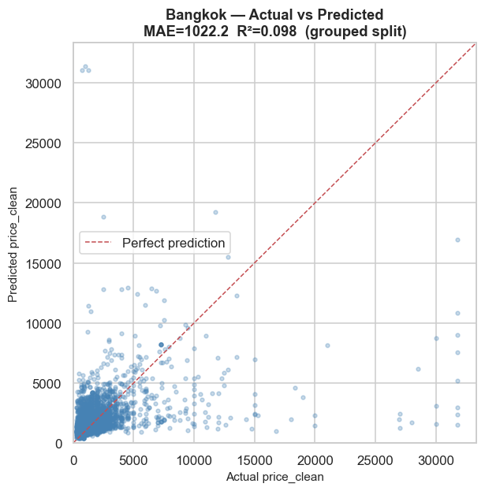

**Cape Town**

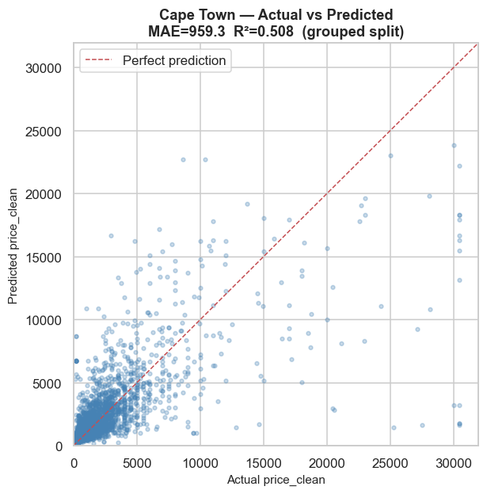

**Hong Kong**

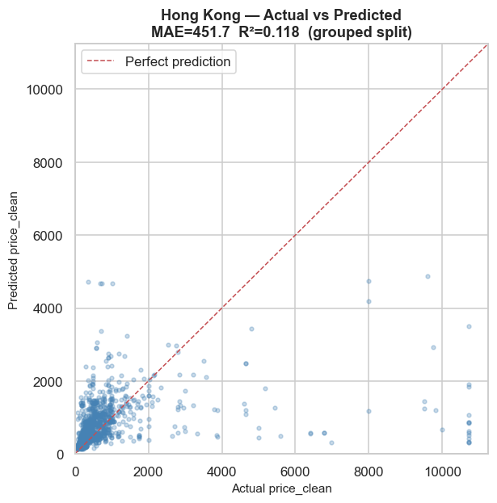

**Istanbul**

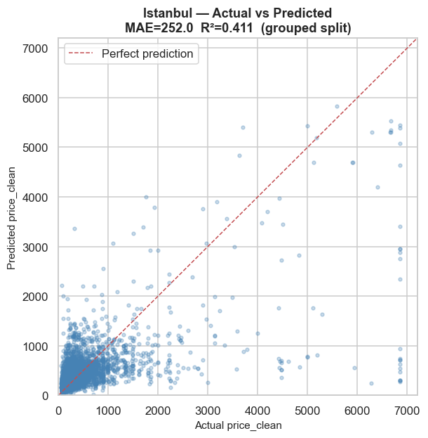

**Mexico City**

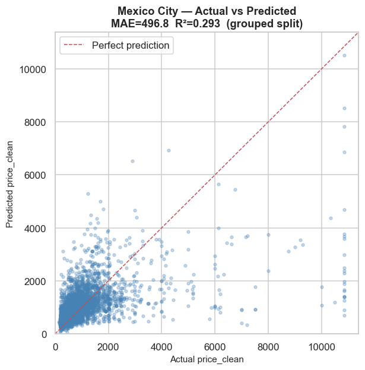

**New York**

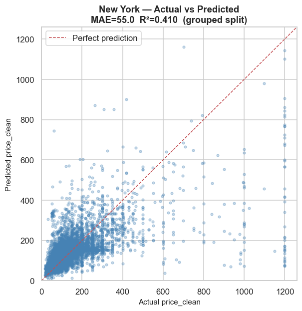

**Paris**

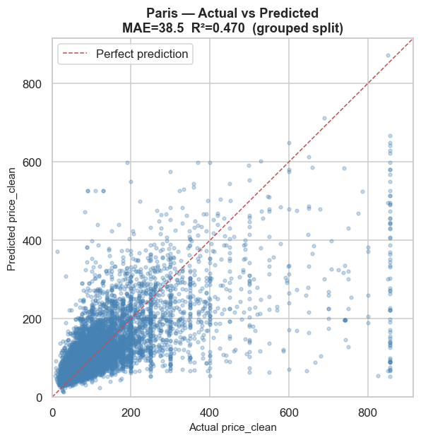

**Rio de Janeiro**

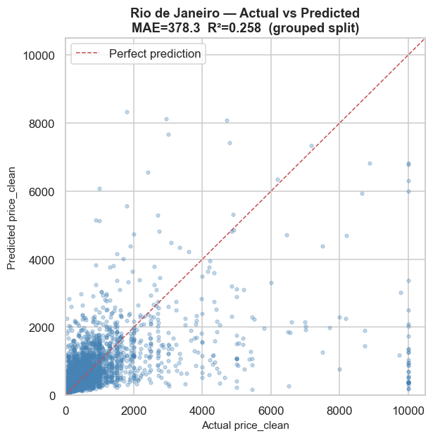

**Rome**

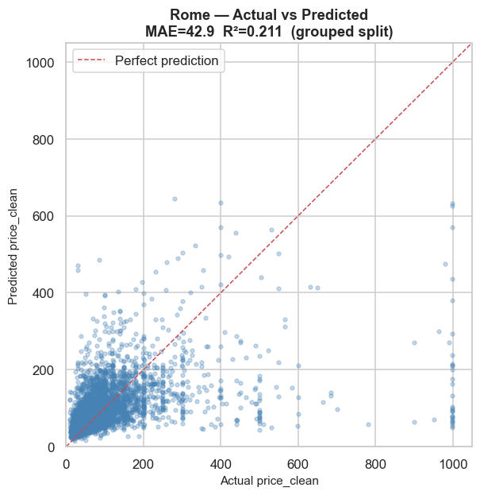

**Sydney**

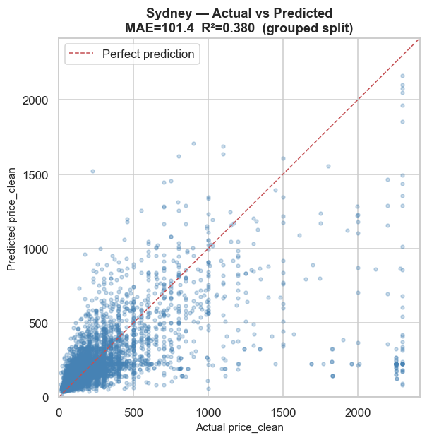

## 4. Residual plots (per city)

**Bangkok**

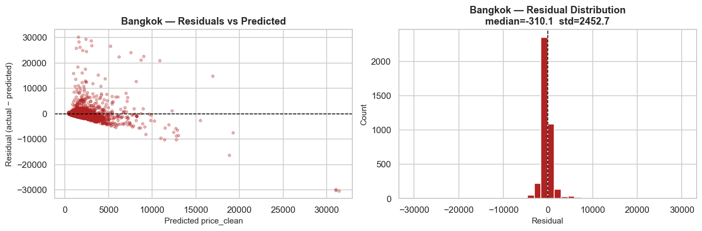

**Cape Town**

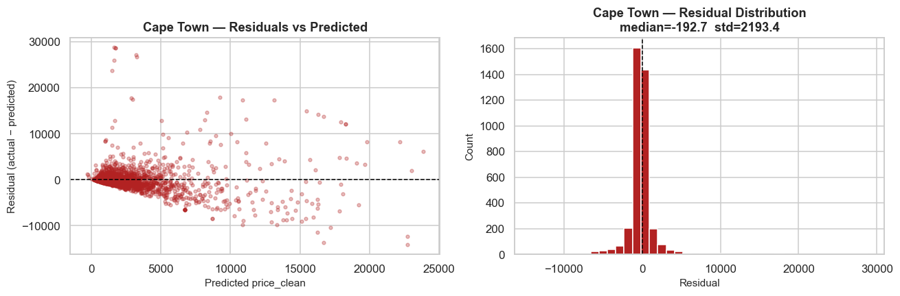

**Hong Kong**

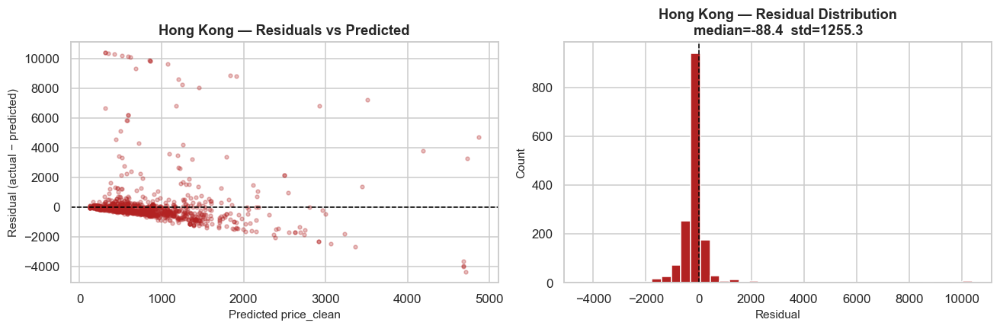

**Istanbul**

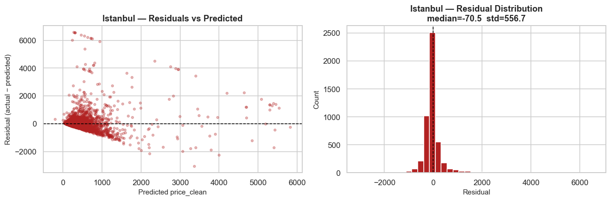

**Mexico City**

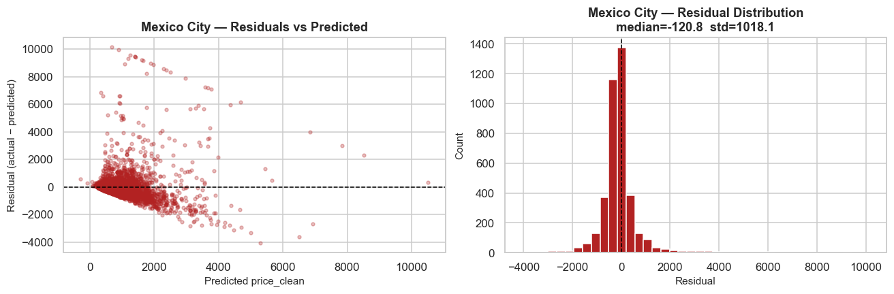

**New York**

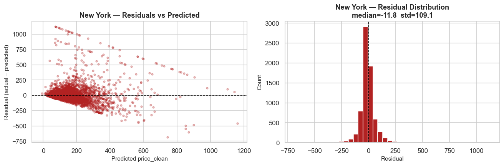

**Paris**

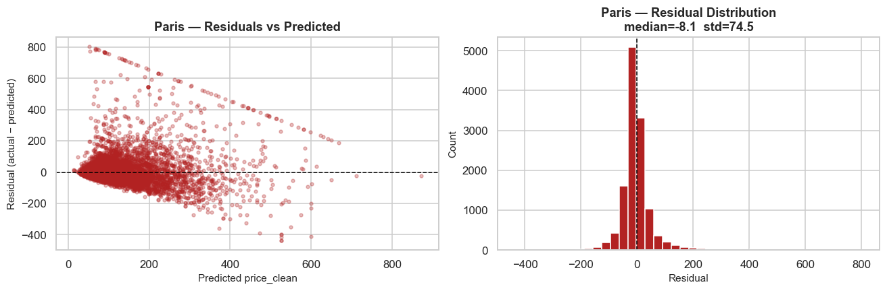

**Rio de Janeiro**

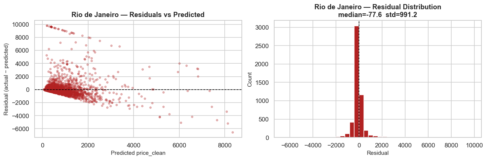

**Rome**

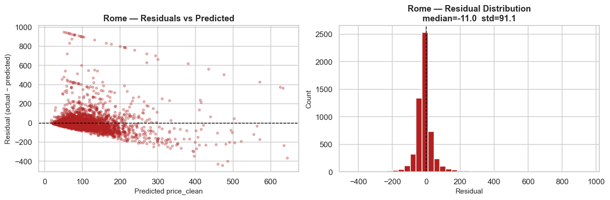

**Sydney**

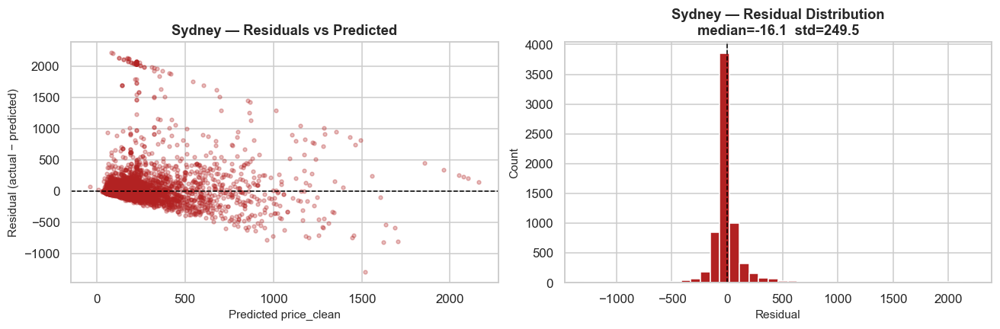

## 5. Sensitivity chart

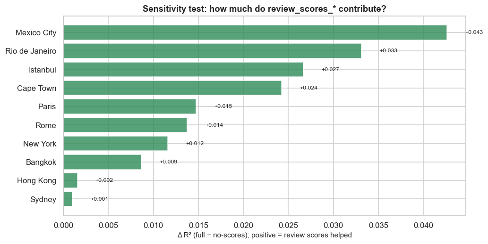

## 6. Known error patterns

- **Heteroscedasticity:** residual spread grows with predicted price. High-priced listings are harder to predict because luxury pricing depends on idiosyncratic factors (design, brand, seasonality) not captured in the available features.
- **Right-skewed residuals:** in several cities the model underpredicts the most expensive listings. The 99.5% per-city clip removed the extreme tail, but the compressed upper range remains difficult.
- **Scale varies by currency:** MAE values are in local currency (Paris €38 vs Bangkok ฿1022). Compare **R²** across cities, not MAE.