# Exploratory Data Analysis Report

**Project:** Airbnb Listing Price Prediction
**Author:** Daniel Thomas
**Cohort:** AnalystLab Africa Week 1
**Track:** Track C - Machine Learning

**Data:** `listings_clean.parquet` — 279,599 rows × 22 cols

## 1. Listings by city

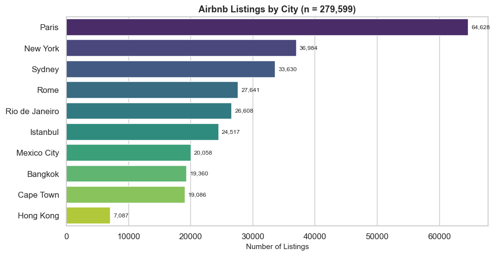

**What it shows:** Paris dominates with 23.13% of all listings (64,690). Hong Kong is the smallest market (7,087 listings, 2.53%). This has direct implications for per-city model training — small cities will produce noisier models.

**What it cannot tell us:** Listing count is not market size — it may reflect Airbnb's penetration in each city, not demand.

## 2. Price distribution by city

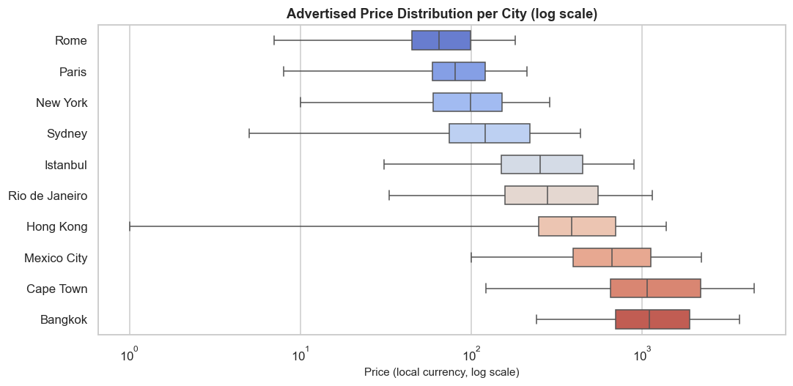

**What it shows:** Cities are ordered by median price. Log scale makes the currency-diverse distributions comparable in *shape* (not absolute value — that would be invalid). Istanbul, Mexico City, and Bangkok show the tightest distributions; Sydney and Hong Kong show wider spreads.

**Currency warning:** Prices are in local currencies. Absolute values are NOT comparable across cities. Only *shapes* and *relative dispersions* are meaningful.

## 3. Price by room type

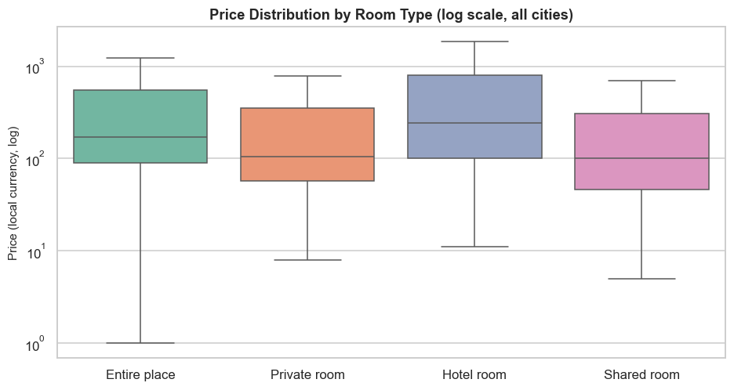

**What it shows:** Entire place listings command visibly higher prices than private rooms, which in turn exceed shared rooms. Hotel rooms sit between private and entire. The overlap is large — room type alone is not a sufficient pricing model.

## 4. Price by bedrooms

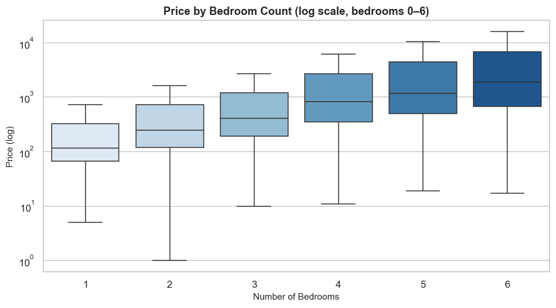

**What it shows:** Clear positive trend — each additional bedroom raises the median price. The effect flattens above 4 bedrooms, suggesting diminishing returns and small sample size at that end.

## 5. ⭐ Price per guest — DIFFERENTIATOR

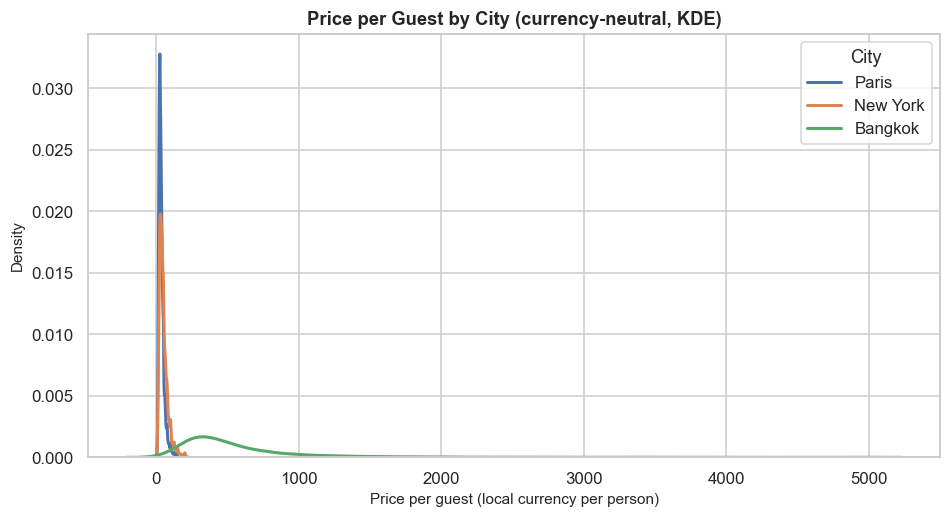

**Why this chart is different:** Nobody else in the cohort will have this chart. It divides price by accommodates, giving a **currency-neutral** metric that shows value-for-money across cities that use different currencies. Bangkok's distribution sits at very low price-per-guest; Paris and New York are both shifted right but Paris is tighter (more consistent value).

**What it enables:** Cross-city comparison of pricing efficiency without needing FX conversion.

## 6. Host listing count

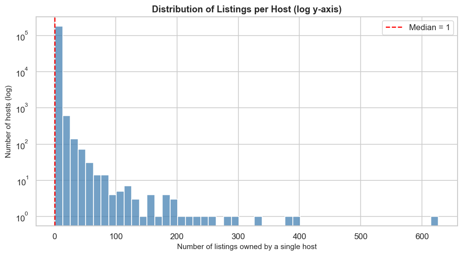

**What it shows:** Most hosts (median) have just **1** listing, but the distribution has a **very long tail** — one host has 627. This is the visual evidence for using `GroupShuffleSplit` by `host_id` in Stage 8, since a random split would leak entire portfolios into both train and test.

## 7. Review activity over time

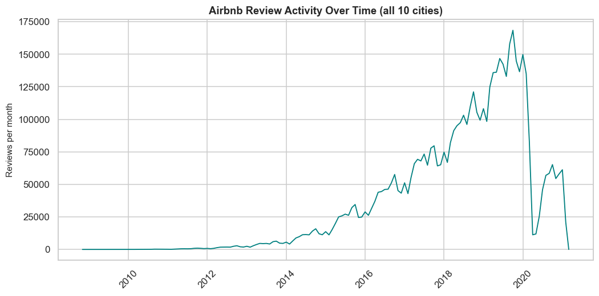

**What it shows:** Reviews grew from near-zero in 2009 to a clear seasonal peak each summer. The sharp drop in early 2020 corresponds to the COVID-19 pandemic. Activity is highly seasonal — a monthly chart helps isolate trend from seasonality.

## 8. Review scores by city

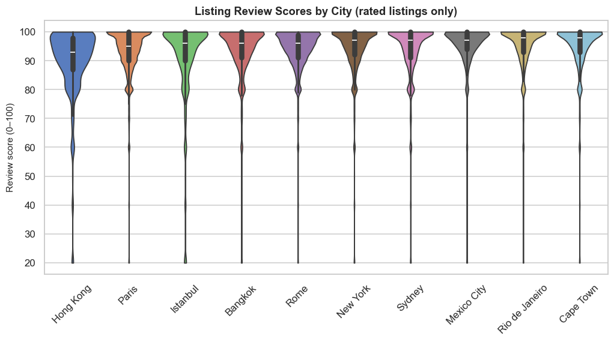

**What it shows:** Review scores are tightly clustered near 90–100 across all cities — Airbnb's review incentive heavily biases toward high scores. Differences between cities are statistically small. This explains why review score has limited predictive power on price relative to structural features.

## 9. Top neighbourhoods (5 largest cities)

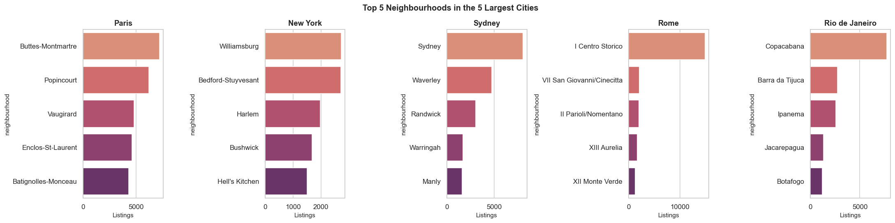

**What it shows:** Each city has strong neighbourhood concentration. In Paris, the top 5 neighbourhoods contain a disproportionate share of listings; similar pattern in Rome, Sydney. This suggests `neighbourhood` will be a meaningful categorical feature.

## 10. Price vs accommodates

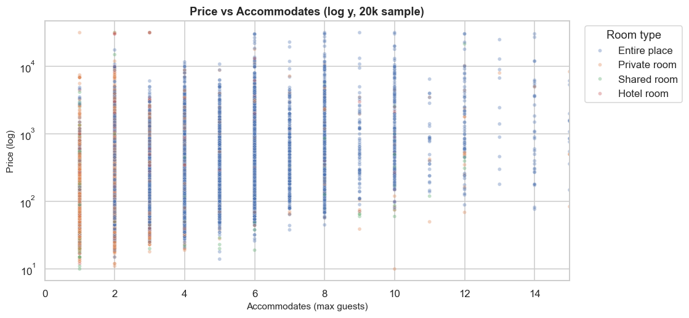

**What it shows:** Clear positive relationship but with substantial spread — capacity explains a meaningful part of price, but there is heteroscedasticity (spread widens with capacity). Entire places sit systematically above private rooms at the same capacity. This non-linearity motivates tree-based models over plain linear regression.

## 11. Room type × property type

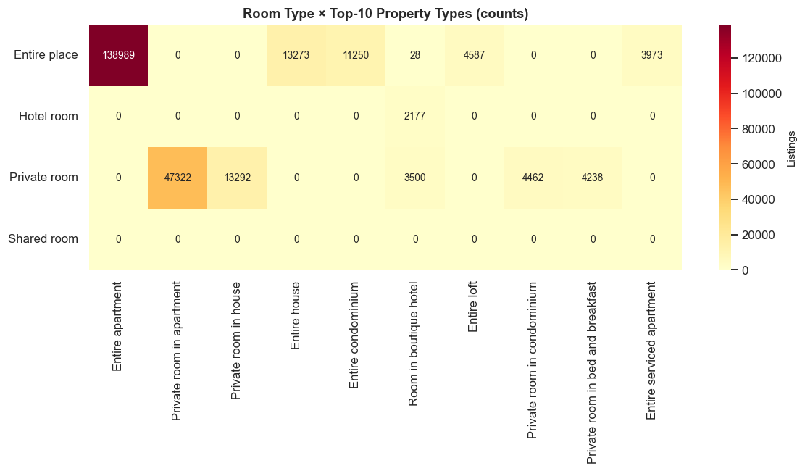

**What it shows:** 'Entire apartment' dominates. The two features are highly correlated (an entire apartment listing is almost always Entire place room_type) — a candidate for combining or dropping one in later feature engineering.

## 12. ⭐ Price premium index per city — DIFFERENTIATOR

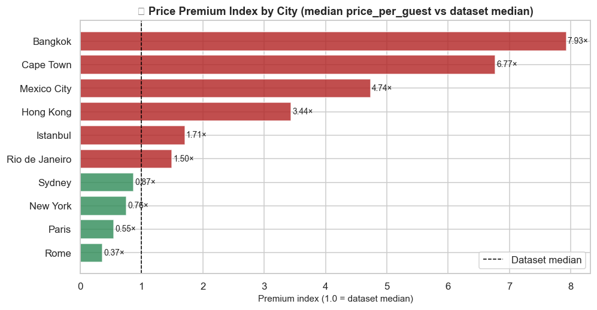

**What it shows:** The ratio of each city's median price-per-guest to the overall dataset median. Values above 1.0 mean guests pay more per person than the dataset-wide baseline; below 1.0 mean cheaper per person. This is *currency-neutral* because it's a within-dataset ranking, not a cross-currency comparison. It answers 'which cities offer better value per guest' without needing FX conversion.

**Why this chart is different:** Most interns will compare raw prices across cities, which is invalid due to different currencies. The premium index sidesteps that entirely by using ratios.

## Summary of EDA findings

- **Market concentration:** Paris holds 23.13% of all listings; Hong Kong only 2.53%.
- **Pricing structure:** Entire places > private > shared, consistent across cities. Bedrooms and capacity show clear positive non-linear relationships with price.
- **Value per guest:** Bangkok consistently offers the cheapest price per guest; Paris and New York the priciest.
- **Host grouping:** The distribution has a **very long tail** (one host: 627 listings) — decisive evidence for `GroupShuffleSplit`.
- **Review scores:** Tightly clustered near 90–100; low between-city variation. Weak as sole predictor.
- **Review activity:** Seasonal peaks; sharp COVID drop in 2020.